# Tutorial 01 — Answers

## Part I

### Question 1
| Input | Process | Output |
|---|---|---|
| number1, number2 | product = number1 × number2 | product |

#### Pseudocode
```text
START
    READ number1, number2
    product ← number1 × number2
    DISPLAY product
STOP
```

##### Flowchart
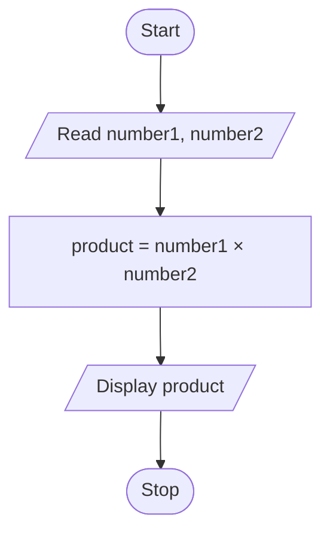

### Question 2

| Input | Process | Output |
|---|---|---|
| A random number, n generated in 0-100 | Compare n with 50| "Greater than 50" or "Not greater than 50" and n |

#### Pseudocode
```text
START
    n ← RANDOM_INTEGER(0, 100)
    IF n > 50 THEN
        DISPLAY n, "Greater than 50"
    ELSE
        DISPLAY n, "Not greater than 50"
    END IF
STOP
```

##### Flowchart
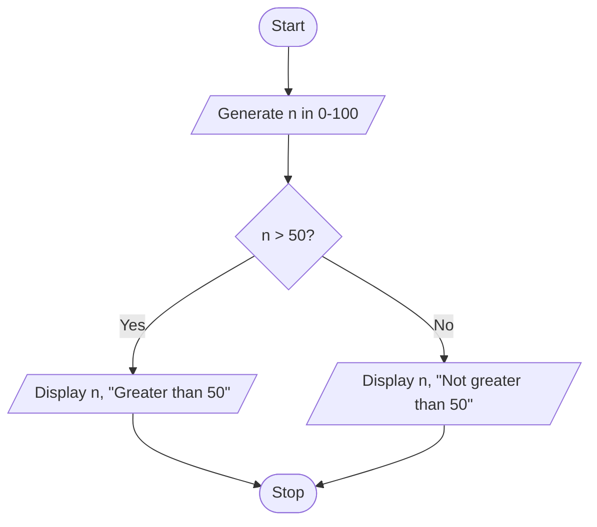

### Question 3

| Input | Process | Output |
|---|---|---|
| Mark | Check whether mark within 0-100 | Invalid mark, Pass or Fail |

#### Pseudocode
```text
START
    READ mark
    IF mark < 0 OR mark > 100 THEN
        DISPLAY "Invalid mark"
    ELSE IF mark >= 40 THEN
        DISPLAY "Pass"
    ELSE
        DISPLAY "Fail"
    END IF
STOP
``` 

##### Flowchart
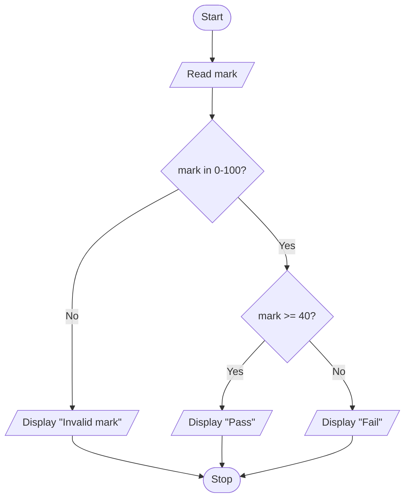

### Question 4
| Input | Process | Output |
|---|---|---|
| Two die value generated in 1-6 | Compare player 1 and player 2 | p1 value, p2 value, winner or draw |

#### Pseudocode
```text
START
    p1 ← RANDOM_INTEGER(1, 6)
    p2 ← RANDOM-INTEGER(1, 6)
    DISPLAY p1, p2
    IF p1 > p2 THEN
        DISPLAY "Player 1 wins"
    ELSE IF p2 > p1 THEN
        DISPLAY "Player 2 wins"
    ELSE
        DISPLAY "Draw"
    END IF
STOP
```

##### Flowchart
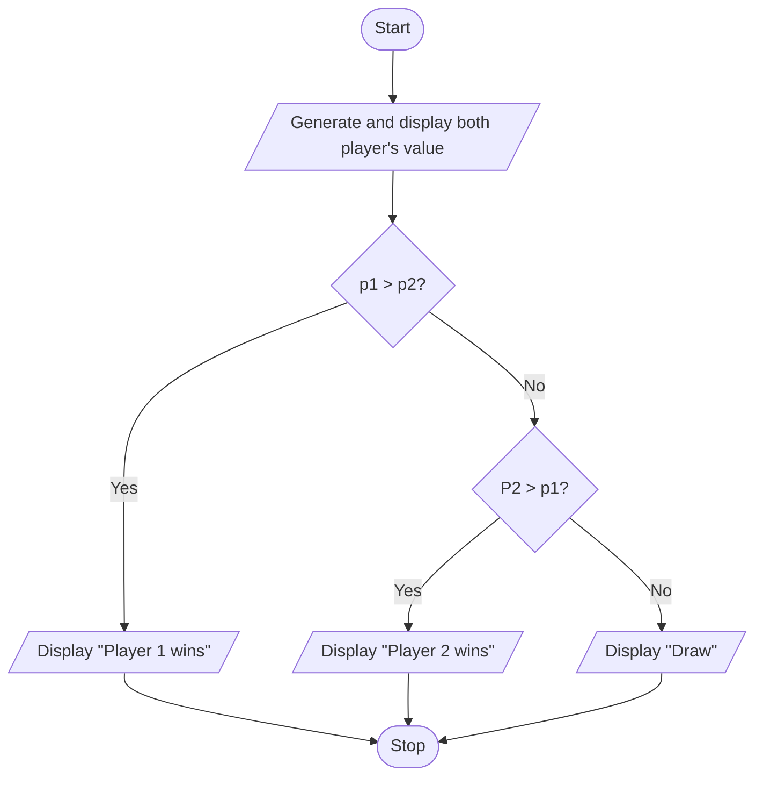

### Question 5
| Input | Process | Output |
|---|---|---|
| length, width | validate; perimeter = 2 × (length + width) | perimeter or "Invalid Dimensions" |

#### Pseudocode
```text
START
    READ length, width
    IF length <= 0 OR width <=0 THEN
        DISPLAY "Invalid Dimensions"
    ELSE
        perimeter ← 2 × (length + width)
        DISPLAY perimeter
    END IF
STOP
```
##### Flowchart
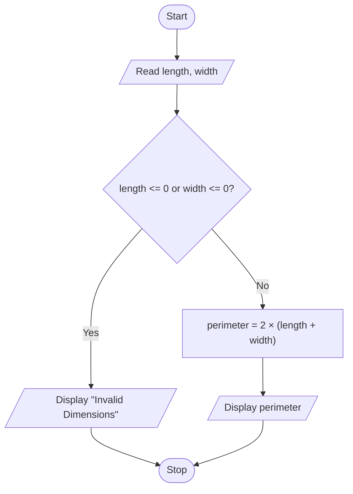

### Question 6
| Input | Process | Output |
|---|---|---|
| 10 integers generated in  0-100 | Track the smallest number while inspecting all 10 integers | number list, minimum |

#### Pseudocode
```text
START
    minimum ← RANDOM_INTEGER(0, 100)
    DISPLAY minimum
    count ← 1
    WHILE count < 10 DO
        n ← RANDOM_INTEGER(0, 100)
        DISPLAY n
        IF n < minimum THEN
            minimum ← n
        END IF
        count ← count + 1
    END WHILE
    DISPLAY minimum
STOP
```

##### Flowchart
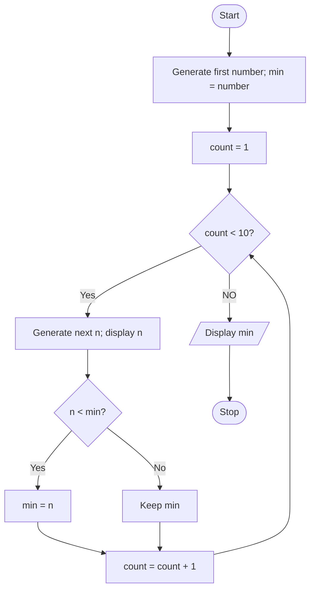

### Question 7
| Input | Process | Output |
|---|---|---|
| 10 integers generated in 10-100 | Check whether divisible by 2; increment odd or even | number list, odd count and even count |

#### Pseudocode
```text
START
    even ← 0
    odd ← 0
    count ← 0
    WHILE count < 10 DO
        n ← RANDOM_INTEGER(10, 100)
        DISPLAY n
        IF n MOD 2 = 0 THEN
            even ← even + 1
        ELSE
            odd ← odd + 1
        END IF
        count ← count + 1
    END WHILE
    DISPLAY even, odd
STOP
```

##### Flowchart
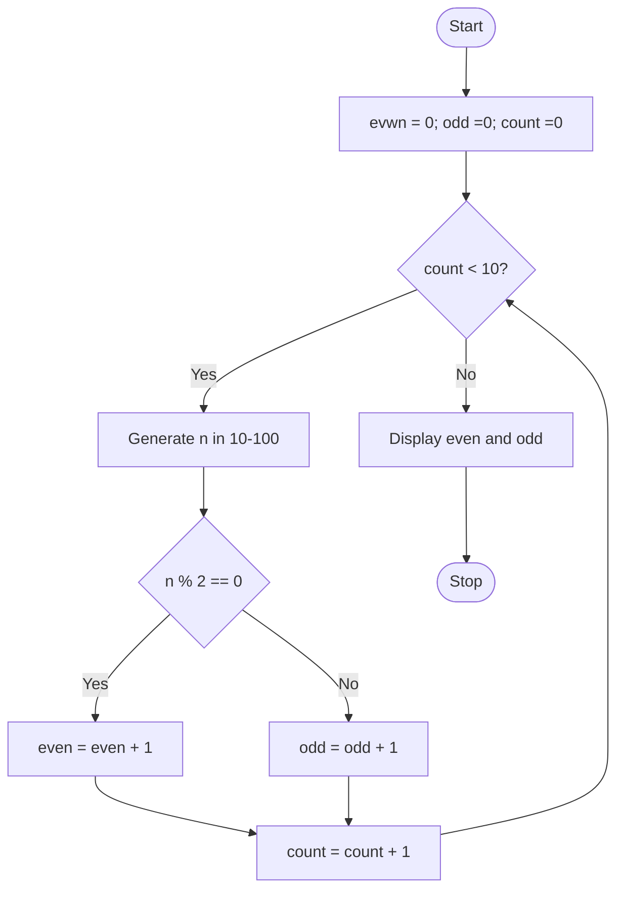

## Part II 

### Question 8
| Input | Process | Output |
|---|---|---|
| sentence | Inspect aech character; count 'U' and 'M' | U count and M count |

```text
START
    READ sentence
    uCount ← 0
    mCount ← 0
    index ← 0
    WHILE index < LENGTH(setence) DO
        char = CHARACTER_AT(sentence, index)
        IF char = 'U' then
            uCount ← uCount + 1
        ELSE IF char ='M' THEN
            mCount ← mCount + 1
        END IF
        index ← index + 1
    END WHILE
    DISPLAY uCount, mCount
STOP
```

##### Flowchart
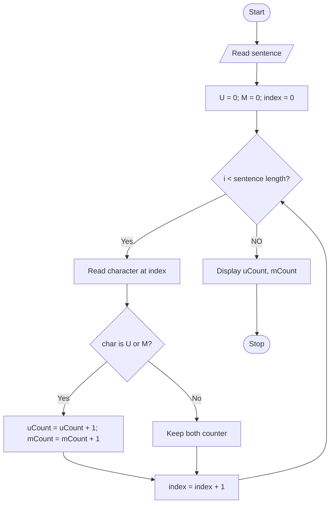

### Question 9
| Input | Process | Output |
|---|---|---|
| Read keyword; Extract page text | Extract word and compare with keyword | Keyword and frequency |

#### Pseudocode
```text
START
    READ pageText, keyword
    VALIDATE keyword is one non-empty word
    words ← TOKENIZE(LOWERCASE(pageText))
    frequency ← 0
    FOR EACH word IN words DO
         IF word = LOWERCASE(keyword) THEN
              frequency ← frequency + 1
         END IF
    END FOR
    DISPLAY frequency, count
STOP
```

##### Flowchart
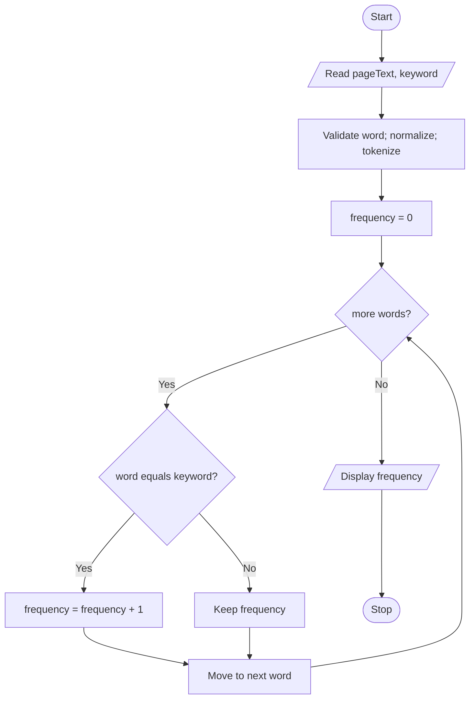

### Question 10
| Input | Process | Output |
|---|---|---|
| 100 students' gender generated randomly | Inspect each gender; count female | gender and female number |

#### Pseudocode
```text
START
    femaleCount ← 0
    FOR index from 1 to 100 DO
        gender ← RANDOM_CHOICE('F', 'M', 'X')
        DISPLAY index, gender
        IF gender = 'F' THEN
            femaleCount ← femaleCount + 1
        END IF
    END FOR
    DISPLAY femaleCount
STOP
```

##### Flowchart
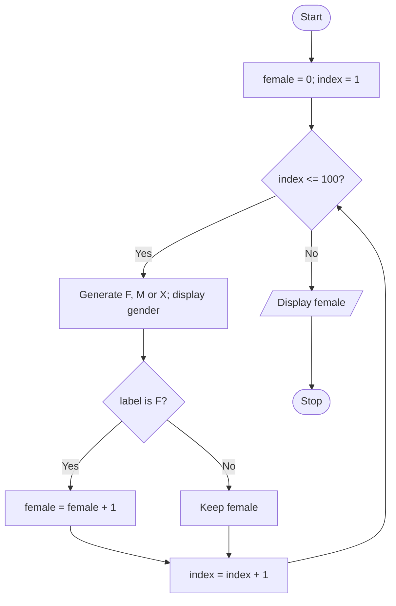

### Question 11
| Input | Process | Output |
|---|---|---|
| 5 integer generated randomly | Sort the array descending | Descending List |

#### Pseudocode
```text
START
    GENERATE five random numbers
    SORT numbers in ascending order
    index ← LENGTH(numbers) - 1
    WHILE index >= 0 DO
         DISPLAY numbers[index]
        index ← index - 1
    END WHILE
STOP
```

##### Flowchart
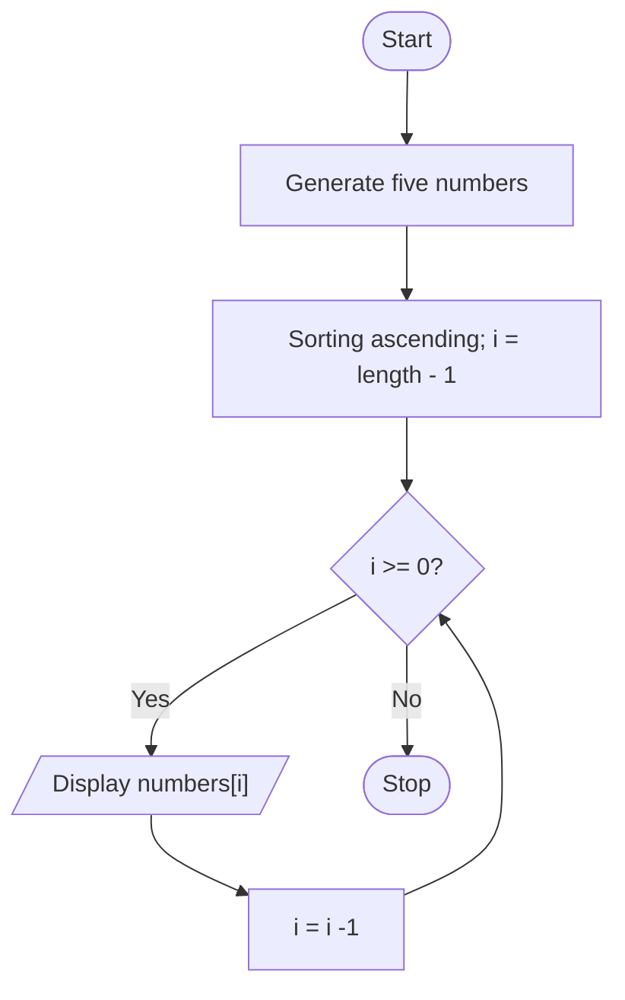
### Question 12
| Input | Process | Output |
|---|---|---|
| target generated randomly in 1-100 and guess | Compare guess with target | Higher, Lower or Correct; attempt count |

#### Pseudocode
```text
START
    target ← RANDOM_INTEGER(1, 100)
    attempt ← 0
    REPEAT
        READ guess
        IF guess < 1 or guess > 100 THEN
            DISPLAY "Enter 1-100"
        ELSE
            attemp ← attempt + 1
            IF guess < target THEN
                DISPLAY "Higher"
            ELSE IF guess > target THEN
                DISPLAY "Lower"
            ELSE
                DISPLAY "Correct", attempt
            END IF
    UNTIL guess = target
STOP
```

##### Flowchart
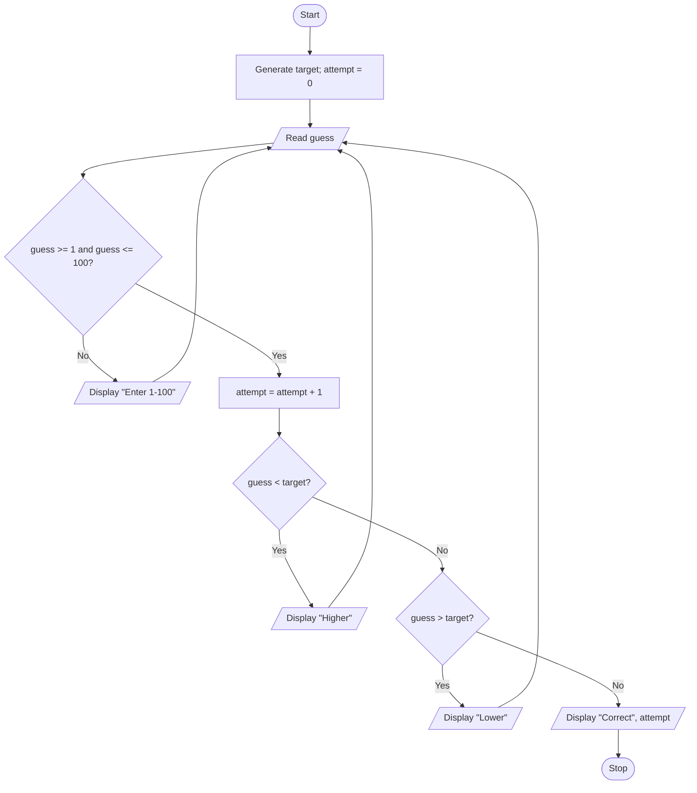
